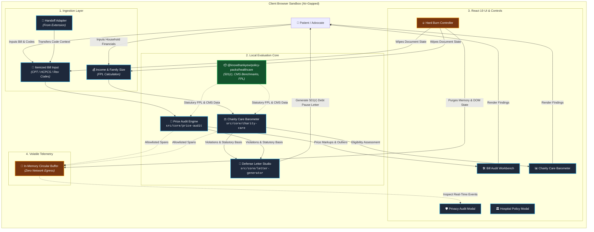
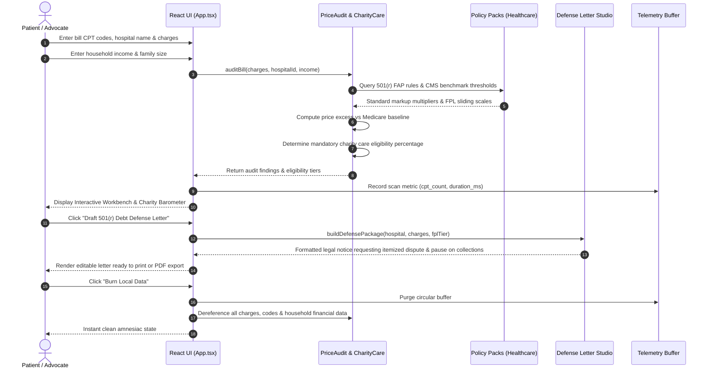

<!-- diagram-meta
  last-validated: 2026-10-19
  covers: [src/**, contracts/**]
  generated-by: manual
-->

# Architecture & Invariants Specification: CareCheck Reality Engine

> Client-side medical bill auditor, hospital chargemaster evaluator, Section 501(r) charity care barometer, and debt defense studio.

---

## 1. Executive Summary

`careCheck` is a client-side reality engine in the `knowthankyew` portfolio built to defend patients against predatory medical billing. Operating under strict Zero Document Egress, it evaluates itemized medical bills against CMS Hospital Price Transparency data (45 CFR Part 180), benchmarks prices against Medicare allowable amounts, calculates income eligibility for statutory Charity Care under 26 U.S.C. § 501(r) and state Fair Pricing Acts, and generates formal dispute and debt-pause notices.

---

## 2. System Architecture & Component Interactions

### A. Execution Sandbox & Trust Boundary



### B. Medical Debt Defense Lifecycle



---

## 3. Core Architectural Invariants

| # | Invariant | Enforcement & Guarantee |
|:--|:----------|:------------------------|
| 1 | **Zero Document Egress** | Medical bills, diagnostic codes, personal identifiers, and income numbers never leave the local browser sandbox. |
| 2 | **Volatile Memory Telemetry** | Operational metrics are held in a fixed-size ring buffer for local inspection only; no cloud transport in consumer builds. |
| 3 | **Strict Key Allowlists** | Telemetry sanitizes properties against `SAFE_ALLOWLIST_KEYS`; diagnosis text, patient names, and exact dollar figures are redacted. |
| 4 | **Compile-Time Dead Code Shims** | Enterprise OTLP exporter symbols are completely excised at build time for standard consumer builds. |
| 5 | **Amnesiac State Purge (Hard Burn)** | Complete memory purge removing sensitive health and financial data without persistence in browser storage. |

---

## 4. Directory Structure

```
careCheck/
├── docs/
│   ├── ARCHITECTURE.md          # Architecture, data flow & invariant specification
│   └── PRIVACY_TELEMETRY_SCHEMA.md # Telemetry contract specification
├── src/
│   ├── App.tsx                  # Root application view & workflow orchestration
│   ├── main.tsx                 # Entrypoint
│   ├── components/              # UI components (BillAuditWorkbench, CharityCareBarometer, DefenseStudio)
│   ├── contracts/               # TypeScript interfaces & handoff contracts
│   ├── core/
│   │   ├── price-audit/         # CMS chargemaster comparison & markup calculation
│   │   ├── charity-care/        # Section 501(r) sliding scale & FPL evaluation
│   │   ├── letter-generator/    # Debt defense & financial assistance letter generation
│   │   ├── handoff-adapter.ts   # Structured Handoff from knowthankyew-extension
│   │   └── telemetry.ts         # In-memory privacy telemetry controller
│   └── styles/                  # Styling & themes
├── tests/                       # Vitest unit test suites
└── vite.config.ts               # Air-gapped bundler configuration
```
